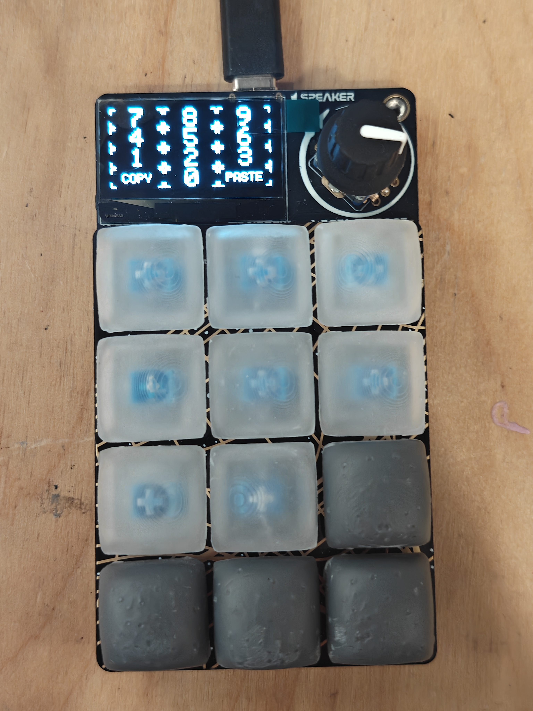
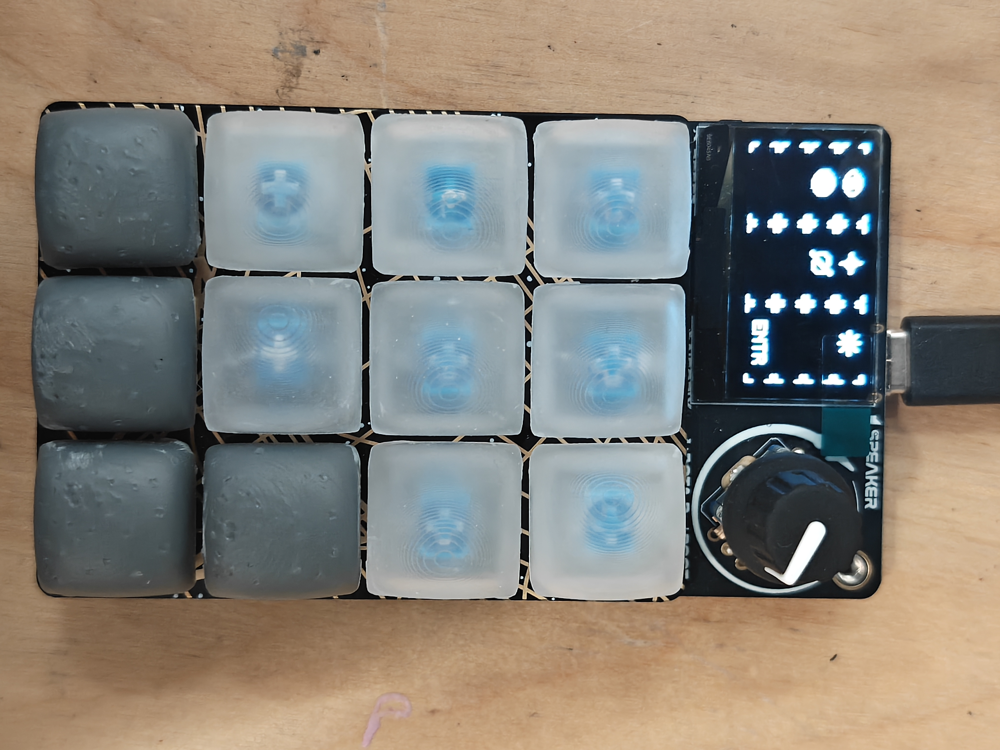
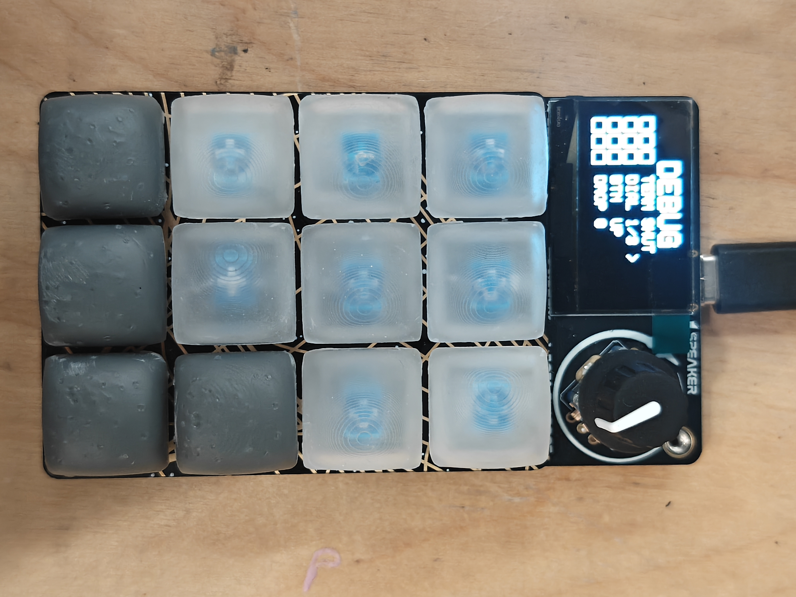
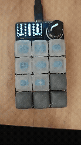
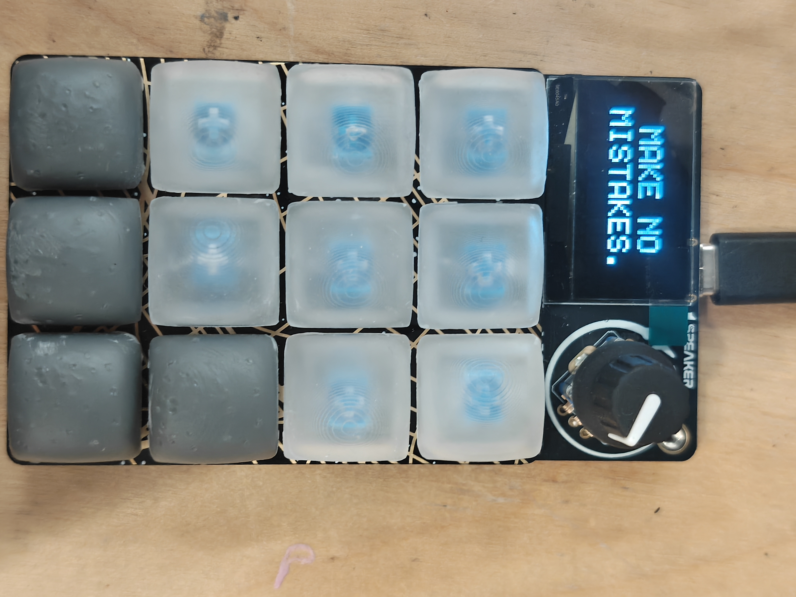

# rad-macro-pad
A macropad, where the drivers are entirely written in C. Does 'rad' things.

## Use

If you are looking to use this project, or it's submodule `rp2040-oled-spi`, they are both available to clone. The CMake should allow for a direct drop in into other projects.

## Project Goals
The goal of this project was to re-program the [Adafruit RP2040 MacroPad](https://www.adafruit.com/product/5128?srsltid=AYCX9vKLo7Zc8QMYrQVxFYPImh0nbvcx8zGKFx6cK3LFHbl48LL_HUkB). Adafruit ships this macropad with a firmware build that users can modify through CircuitPython scripts. Instead of building on top of this framework, our team developed a brand-new C firmware architecture from scratch, built with the pico-sdk, and flashed directly to the onboard RP2040 microcontroller.

We aimed to re-create the core functionality one would expect from a macropad as well as add a few fun and unexpected features! The final list of features implemented is:
- Register key presses 
- Switch “modes” via the rotary dial
- Display the current mode on the screen
- Send key presses to a host via USB
- Inject keystrokes over USB
- Create a debug tool that communicates via USB

## Personal Goals

Ram: I approached this project wanting to learn about PIO, but with the speeds in which we were writing to the display, that ended up not being useful. However, learning how to work with other's code and create new things from it was a powerful tool. I also wanted to learn more about communicating over USB through something like CDC, and I learned exactly what that was. Before, it was a black box, but now I understand that it is extremely similar to UART, just in the context of the USB protocol.

Jacob: I was looking forward to the chance to write embedded C code in a different application than I have done previously. One of my primary learning goals was learning how to interact with a computer using the USB protocol. I also wanted the final product to be complete and polished. Looking back, I feel that I met my learning goals and am happy with our final product.

## System Architecture

## Pictures

### Numpad mode

### "Prompt Engineer" mode

### Debug Mode

### Transition

### "Make No Mistakes."

### `rp2040-oled-spi`
The display built into the Adafruit RP2040 MacroPad uses SPI to communicate with the SH1106 display driver. There were not existing drivers available for this, so we decided to find one similar. This allowed us to focus less on the implementation of writing everything to the display, but still required us to understand the display driver and learn how to communicate with it. [@sm00th](https://github.com/sm00th) created a OLED driver that communicates over I^2C, and so we forked that driver and rewrote it to communicate over SPI, which results in a significant speed boost (updates possible every 26ms -> updates possible every 1ms). Implementation is documented and detailed in [`rp2040-oled-spi`](https://github.com/foxwithahdie/rp2040-oled-spi).

### HID interactions, and keystroke injection

### CDC communication

The Adafruit RP2040 MacroPad does not come with a UART to USB bridge, so to communicate with our computer to have some form of telemetry, we had to write directly to the virtual port / COM port. Using TinyUSB, we also implemented a set of features which allows us to use print functions, particularly ones that are nonblocking. To achieve this, instead of using `printf`, we wrote our own print implementation that formats your sentence and sends information to a queue, which as the TinyUSB driver does it's work, eventually sends to the microcontroller. Details are in `usb_cdc_comms.h/c`.

## Debugging Experience

One main section that caused an issue was the USB-CDC printing/queuing. Originally, with the way that the printing data pool worked, you could have multiple messages in the queue and initially write over them, which caused some weird garbling issues while printing because making new data messed with the previous unsent data. To combat this, there is a built in refusal return, which doesn't allow printing if there isn't enough space in the printing pool, and checks the end and beginning of the printing pool to confirm if the data that is there has already been sent or if it is actively in the queue.

## Design Decisions

Originally, the key press interactions were built using interrupts to form an event-driven architecture. However, due to the mechanical "bounce" of key switches, a single key press results in a number of rising and falling edges. To continue with an interrupt-defined architecture, we would have to debounce each of the keys. We decided that the artificial latency added by debouncing would nullify the benefit of an event-driven architecture. Instead we opted for a polling strategy, where each key is polled every 5ms, much faster than a human can perceive. This approach simplifies the code and is the same strategy taken by existing keyboard firmware, such as QMK.

## Future Work
There were a few cool features that we didn't have a chance to implement within the scope of this project:
- RGB LEDs 
- Buzzer 
- Mouse input to a host

## AI Usage
Most of the project was coded by hand. Display aesthetics were coded using generative AI. Generative AI was used for code/architecture review and debugging.

-covering what you built
-the design decisions you made and why
-a reflection on your debugging experience
-include a section about how you used ai in this project
