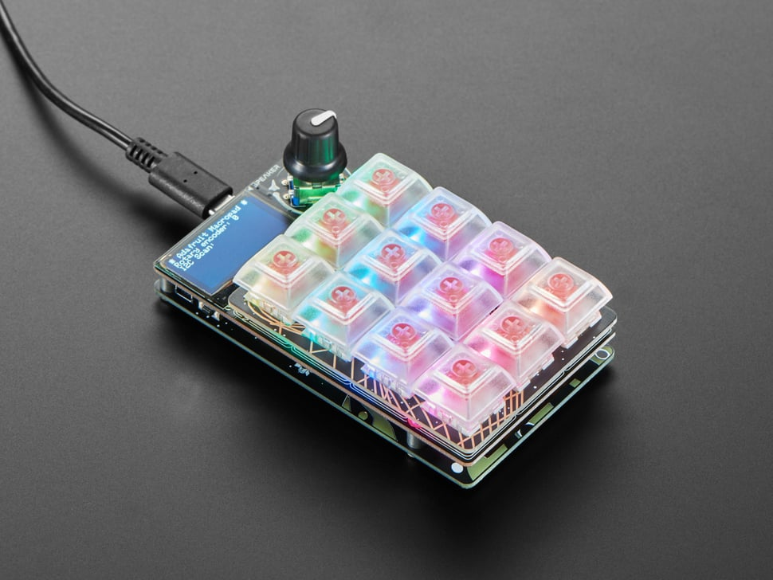
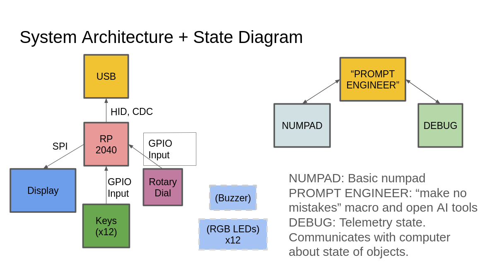

# rad-macro-pad
A macropad, where the drivers are entirely written in C. Does 'rad' things.

## Use

If you are looking to use this project, or it's submodule `rp2040-oled-spi`, they are both available to clone. The CMake should allow for a direct drop in into other projects.

## Project Goals
The goal of this project was to re-program the [Adafruit RP2040 MacroPad](https://www.adafruit.com/product/5128?srsltid=AYCX9vKLo7Zc8QMYrQVxFYPImh0nbvcx8zGKFx6cK3LFHbl48LL_HUkB). Adafruit ships this macropad with a firmware build that users can modify through CircuitPython scripts. Instead of building on top of this framework, our team developed a brand-new C firmware architecture from scratch, built with the pico-sdk, and flashed directly to the onboard RP2040 microcontroller.

We aimed to re-create the core functionality one would expect from a macropad as well as add a few fun and unexpected features! The final list of features implemented is:
- Register key presses 
- Switch “modes” via the rotary dial
- Display the current mode on the screen
- Send key presses to a host via USB
- Inject keystrokes over USB
- Create a debug tool that communicates via USB

## System Architecture

### `rp2040-oled-spi`
The display built into the Adafruit RP2040 MacroPad uses SPI to communicate with the SH1106 display driver. There were not existing drivers available for this, so we decided to find one similar. This allowed us to focus less on the implementation of writing everything to the display, but still required us to understand the display driver and learn how to communicate with it. [@sm00th](https://github.com/sm00th) created a OLED driver that communicates over I^2C, and so we forked that driver and rewrote it to communicate over SPI, which results in a significant speed boost (updates possible every 26ms -> updates possible every 1ms). Implementation is documented and detailed in [`rp2040-oled-spi`](https://github.com/foxwithahdie/rp2040-oled-spi).

### HID interactions, and keystroke injection

### CDC communication

The Adafruit RP2040 MacroPad does not come with a UART to USB bridge, so to communicate with our computer to have some form of telemetry, we had to write directly to the virtual port / COM port. Using TinyUSB, we also implemented a set of features which allows us to use print functions, particularly ones that are nonblocking. To achieve this, instead of using `printf`, we wrote our own print implementation that formats your sentence and sends information to a queue, which as the TinyUSB driver does it's work, eventually sends to the microcontroller. Details are in `usb_cdc_comms.h/c`.

## Debugging Experience

One main section that caused an issue was the USB-CDC printing/queuing.

## Future Work
There were a few cool features that we didn't have a chance to implement within the scope of this project:
- RGB LEDs 
- Buzzer 
- Mouse input to a host

## AI Usage
Most of the project was coded by hand. Display aesthetics were coded using generative AI. Generative AI was used for code/architecture review and debugging.

-covering what you built
-the design decisions you made and why
-a reflection on your debugging experience
-include a section about how you used ai in this project
